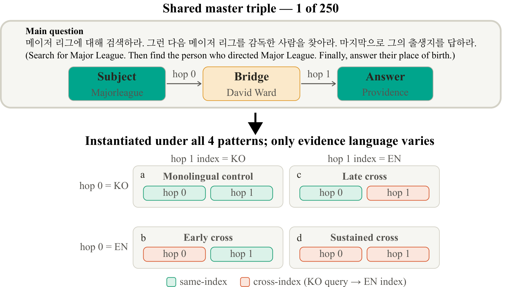

# K-CrossHop

Code and evaluation outputs for **K-CrossHop: A Two-Stage Decomposition of
Query-Side Cross-Lingual Failures in Korean–English Two-Hop RAG**
(Findings of EACL 2027).


[](https://huggingface.co/datasets/yjyoon/K-CrossHop)
[](LICENSE)
[](LICENSE-DATA)

**Young Je Yoon**, **Tae Joo Shin**<sup>\*</sup>  
Ulsan National Institute of Science and Technology (UNIST)  
<sub><sup>\*</sup>Corresponding author</sub>

K-CrossHop is a hop-controlled benchmark for diagnosing where and why
cross-lingual failures arise in Korean–English two-hop retrieval-augmented QA.
**The question is always Korean; only the language of the evidence each hop
must retrieve varies.** Every entity path is instantiated under all four
evidence-language patterns, so same-index and cross-index hops are compared on
the same paths. A graded query chain then separates query-template language
mismatch from the surface-form mismatch of the bridge entity carried into the
next hop. Because faithfulness is scored only on answered hops, we also measure
faithful-answer yield, which exposes losses that appear as abstention.

<p align="center"></p>
<p align="center"><sub><b>Matched evaluation design.</b> Each entity path is
evaluated under all four evidence-language patterns: the Korean question and the
entity path stay fixed, and only the language of the evidence each hop must
retrieve varies.</sub></p>

## At a glance

- **Entity paths** — 250 two-hop Wikidata paths (subject → bridge → answer)
- **Questions** — 1,000 = 250 paths × 4 evidence-language patterns, 250 per pattern
- **Patterns** (query → hop0 evidence → hop1 evidence) — a KO→KO→KO · b KO→EN→KO · c KO→KO→EN · d KO→EN→EN
- **Models** — Aya Expanse 8B, EXAONE 3.5, Llama 3.1 8B, Qwen3 8B, Claude Sonnet 4.6, Gemini 3.5 Flash
- **Query conditions** — Controlled, template-matched, surface-normalized (§3.2 of the paper)
- **Annotation** — Claim-level LLM judge, plus three human audits (judge agreement, abstention parser, retrieval proxy)

## Key findings

Yield is the proportion of hops producing a non-abstained, faithful answer. All
intervals are 95% bootstrap confidence intervals that resample the 250 entity
paths as clusters.

- **Cross-index retrieval reduces faithful-answer yield.** Across all six models,
  Korean queries retrieving from the English index produce lower yield than
  queries retrieving from the Korean index on matched entity paths (gap +0.073
  to +0.117; all 95% CIs exclude zero).
- **Two query-side mismatches account for most of the yield gap.** Applied in sequence,
  matching the query template to the evidence language recovers the dominant
  share of the yield gap (+0.061 to +0.098), and then normalizing the surface
  form of the bridge entity carried into the next hop recovers a smaller
  additional share (+0.017 to +0.036). Both components are significant across
  all six models.
- **Bridge-surface effects are concentrated on person bridges.** The
  bridge-surface component is significant for all six models on the 109 paths
  whose bridge is a person, but for none on the 115 paths whose bridge is an
  organization.
- **Abstention shapes how the loss becomes visible.** All four 8B models show
  significant cross-index faithfulness gaps (+0.035 to +0.100), while neither
  frontier model does (−0.002 and +0.026). Nevertheless, the frontier models
  exhibit similarly large yield gaps (+0.093 and +0.117), with the loss
  manifesting primarily through abstention. Faithfulness alone therefore
  conceals a substantial reduction in usable answers.

## Quickstart

```bash
git clone https://github.com/Yoonyoungje/K-CrossHop.git && cd K-CrossHop
pip install -r requirements.txt        # Python 3.11; install a CUDA build of torch separately
hf download yjyoon/K-CrossHop --repo-type dataset --local-dir data
```

The dataset repository unpacks into `data/` at the code root (layout below).
Every metric (07–16) runs from the released trajectories and annotations alone;
no API key, GPU or corpus is needed for that.

Reproduce one result — the faithfulness gap and its 95% CI for one model:

```bash
python3 analysis/13_bootstrap_ci.py \
    --annotated data/annotated/sonnet_ecological.jsonl \
    --qa-pairs data/dataset/qa_pairs.jsonl \
    --cluster-bootstrap --cluster-key path_cluster_id
```

Reproduce every reported output and compare it with the shipped copy:

```bash
bash tools/verify_baseline.sh /tmp/k-crosshop-out    # about 90 minutes on CPU; prints OK or the diff per output
```

Three of the added analyses in this run read `data/corpus/` (see below).

## Repository layout

```
pipeline/      01–06: path extraction → passages → questions → index → generation → judge
analysis/      07–16: metrics, decompositions, bootstrap CIs, retrieval proxy, added analyses
dataset/       dataset construction (oracle gate, templates, caps, labels)
audit/         human-audit sampling and scoring, the construction audit, release checks
scripts/       camera_ready/: one script per added analysis, each writing to results/camera_ready/
tools/         verify_baseline.sh — reruns every reported output and diffs it
utils/         shared helpers — metrics, parsing, language, QA-set restriction
tests/         unit tests (pytest tests/ -q)
results/       the reported metric outputs; camera_ready/ holds the added analyses
human_audit/   human-audit labels and scores; instruments/ holds the rubrics
```

```
data/
  dataset/        qa_pairs.jsonl (1,000 questions), triples.jsonl (250 paths), paths.jsonl
  trajectories/   {model}_{condition}.jsonl   agent traces, with each hop's top-5 passages
  annotated/      {model}_{condition}.jsonl   LLM-judge claim labels
  retrieval/      answer-bearing hit@5 per hop, Wikidata alias cache
  construction/   oracle-gate decisions and intermediate path lists of the dataset build
  corpus/         Korean and English Wikipedia passages (needed only to rebuild the indices)
  camera_ready/, self_translate/, correctness/, human_audit/   inputs of the added analyses
```

`{model}` ∈ `aya` `exaone` `llama` `qwen` `sonnet` `gemini`;
`{condition}` ∈ `ecological` `query_matched` `normalized` (see below).
Field-level documentation is in [DATASHEET.md](DATASHEET.md) and
`analysis/TRAJECTORY_FIELDS.md`.

## Reproducing the paper

* **Per-table commands** are in [REPRODUCE.md](REPRODUCE.md).
  `tools/verify_baseline.sh` runs all of them and diffs each output against
  `results/`; it is the reference command for every number in the paper.
* **Added analyses** (matched pairs, model-size ladder, E5 retriever, bridge-only condition,
  self-translation, sensitivity, judge-leniency and construction audits) each have a script in
  `scripts/camera_ready/` and outputs in `results/camera_ready/<analysis>/`. The
  screening, exclusion and E5-truncation analyses need `data/corpus/`; the
  E5-truncation analysis also downloads the `intfloat/multilingual-e5-large`
  tokenizer.
* **Confidence intervals** are percentile bootstrap with B = 10,000 and
  seed = 42, resampling the 250 entity paths (all four patterns of a path are
  drawn together; `--cluster-bootstrap --cluster-key path_cluster_id`). Given
  the released annotations they reproduce exactly.
* **What needs a GPU or API keys**: rebuilding the FAISS indices
  (`pipeline/04_build_faiss.py`, about 20 minutes on a GPU), generating
  trajectories (05) and judging them (06). Copy `.env.example` to `.env` and
  supply your own keys; none are included.
* **Determinism**: decoding is greedy, so the open-weight runs are
  deterministic. The two frontier models were called through undated API
  aliases and the judge is not deterministic on rerun, so regenerated outputs
  can differ; the released annotations are the ones the paper uses.

Reported runs used Python 3.11, Ollama 0.23.1 serving the open-weight models
at Q4_K_M, `faiss-cpu` over BAAI/bge-m3 embeddings, and one NVIDIA RTX 5070 Ti
(16 GB), about 6 GPU-hours in total for the generation runs.

## Query conditions and file names

The released file suffixes predate the paper's condition names. They label the
same three conditions:

| Paper condition (§3.2) | File suffix | 05 mode | `run_metadata.trajectory_mode` |
|---|---|---|---|
| **Controlled** (Korean-query cascade) | `ecological` | `--retrieval-mode dynamic_subq` | `dynamic_controlled` |
| **Template-matched** | `query_matched` | `--retrieval-mode dynamic_subq_qmatched` | `dynamic_ablation_raw` |
| **Surface-normalized** | `normalized` | `--retrieval-mode dynamic_subq_norm` | `dynamic_ablation_normalized` |

In all three, hop1's bridge entity is hop0's own answer, so hop0 errors
propagate, and each hop searches its gold-language index. The conditions differ
only in the query string: at hop0 the generator always receives the Korean
sub-question, while at hop1 the condition's query string is both the retrieval
query and the question given to the generator. The headline gaps are computed
on `ecological`. The
successive differences define the decomposition:

* `ecological` → `query_matched`: the **template-language component**
* `query_matched` → `normalized`: the **bridge-surface component**
* what remains at `normalized`: the residual

Classify hops as same-index or cross-index with `design_query_index_match`, not
with `lang_switch` (a transition flag), and compute hop-level metrics through
the shared functions in `utils/metrics.py`.

## Metric names

The paper spells metrics out; code, fields and `results/` files use the
abbreviations.

| Paper term | Code term | Script |
|---|---|---|
| faithfulness | `FaithRate` (`utils/metrics.hop_faith`) | 07 |
| faithfulness gap (Δf) | `LSHD_end2end` | 07, 13 |
| yield gap (Δy) | `Yield-LSHD` (per hop `utils/metrics.hop_yield`) | 07, 13 |
| retrieval-conditioned faithfulness gap | `LSHD_conditioned` | 12 |
| template-language / bridge-surface components | `QMC` stage 1 / stage 2 | 11, `analysis/yield_qmc_joint_ci.py` |
| error-persistence rate | `CLEPR` | 07, 11 |
| abstention rate | `AFR` | 07 |
| parametric fallback rate | `PDR` in `16_pdr_analysis.py` | 16 |
| answer-bearing hit@5 | `answer_bearing_hit` | 12 |

> ⚠️ `07_analyze.py` also prints a quantity named `PDR` (unsupported claims /
> all claims). It is unrelated to the paper's parametric fallback rate, which
> is the one computed by `16_pdr_analysis.py`.

## Licence and intended use

Code is released under the MIT licence ([LICENSE](LICENSE)). The data is
licensed by component: Wikipedia-derived text under CC BY-SA 4.0,
Wikidata-derived structure under CC0 1.0, and stored model outputs under the
terms of the model that produced them ([LICENSE-DATA](LICENSE-DATA)).

**Research use only.** Two of the four open-weight models are released under
non-commercial or research-only licences, and their stored generations inherit
those terms; see the dataset card before reusing model outputs.

## Citation

```bibtex
@inproceedings{kcrosshop2027,
  title     = {K-CrossHop: A Two-Stage Decomposition of Query-Side Cross-Lingual Failures in Korean--English Two-Hop {RAG}},
  author    = {Yoon, Young Je and Shin, Tae Joo},
  booktitle = {Findings of the Association for Computational Linguistics: EACL 2027},
  year      = {2027}
}
```
